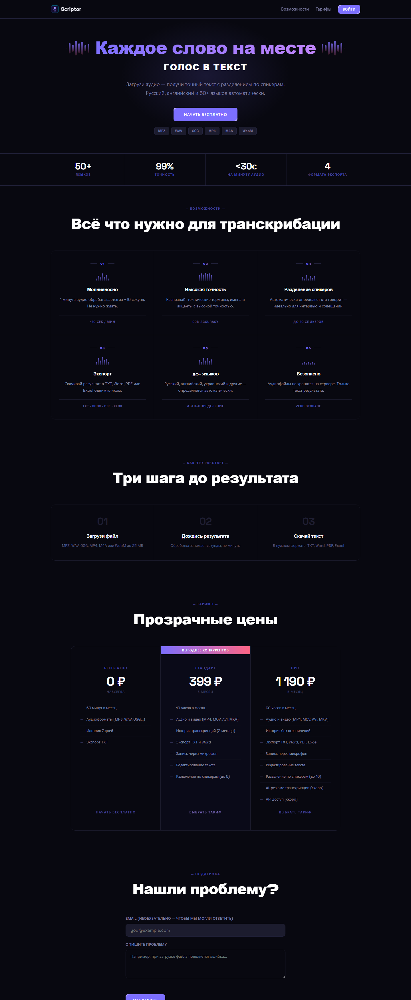

# Scriptor - сервис расшифровки аудио в текст

Веб-сервис распознавания речи: пользователь загружает аудио или видео, получает текст с разбивкой по спикерам и таймкодами, правит его в браузере и выгружает в DOCX, PDF, XLSX или TXT.

Проект сделан в одиночку от идеи до продакшена: продукт, архитектура, бэкенд, фронтенд, приём платежей, рассылки, админ-панель, деплой и подключение домена. Работал на getscriptor.ru. Сейчас переезжает на российскую инфраструктуру: прежний хостинг и CDN стали недоступны из РФ.

Это витрина проекта. Исходный код лежит в закрытом репозитории, доступ по запросу.



## Стек

| Слой | Технологии |
|---|---|
| Бэкенд | Python, FastAPI, SQLAlchemy 2.0, Uvicorn |
| База данных | PostgreSQL (продакшен), SQLite (локальная разработка) |
| Распознавание речи | AssemblyAI API |
| Авторизация | JWT (python-jose), хеширование паролей bcrypt/passlib |
| Платежи | ЮKassa API: создание платежа, webhook, проверка статуса |
| Почта | Resend: подтверждение регистрации, сброс пароля, уведомления |
| Экспорт | python-docx, fpdf2, openpyxl |
| Фронтенд | HTML, CSS, vanilla JavaScript (без фреймворков) |
| Инфраструктура | Railway, собственный домен |

## Что реализовано

**Транскрибация**
- Загрузка аудио и видео (mp3, wav, m4a, mp4, mov, avi, mkv) до 200 МБ
- Расшифровка по ссылке на видео
- Разбивка текста по спикерам и таймкодам, переименование спикеров
- Редактирование результата в браузере
- Экспорт в DOCX, PDF, XLSX, TXT

**Аккаунты и тарифы**
- Регистрация с подтверждением почты, JWT-авторизация, сброс пароля
- Три тарифа с разными лимитами минут в месяц и глубиной хранения истории
- Помесячный учёт израсходованных минут, проверка квоты перед запуском задачи
- Защита от перебора: лимит попыток входа и регистраций

**Платежи**
- Интеграция с ЮKassa: создание платежа, редирект, обработка `payment.succeeded` и `payment.canceled`
- Webhook не доверяет содержимому уведомления: статус перепроверяется отдельным запросом к API ЮKassa
- Повышение тарифа пользователя после подтверждения оплаты

**Админ-панель**
- Статистика по пользователям, расшифровкам и выручке
- Ручное управление тарифами и верификацией пользователей
- Просмотр логов ошибок, сбор обратной связи
- Флаг внутренних аккаунтов, чтобы тестовые данные не попадали в статистику

## Архитектура

```
backend/
├── main.py       # FastAPI: роуты, транскрибация, экспорт, админка, логирование ошибок
├── database.py   # SQLAlchemy-модели: User, Transcription, Payment, Feedback, ErrorLog
├── auth.py       # JWT, хеширование паролей
├── usage.py      # Лимиты тарифов, подсчёт минут за месяц, проверка квоты
└── payments.py   # ЮKassa: создание платежа, webhook, проверка статуса

frontend/
├── index.html    # Лендинг
├── app.html      # Рабочее приложение
├── admin.html    # Админ-панель
├── app.js        # Загрузка файлов, опрос статуса задачи, редактор, экспорт
├── auth.js       # Регистрация, вход, выбор тарифа
└── style.css
```

Около 3 300 строк кода.

## Как это сделано

Проект написан в парадигме vibe-coding: основной инструмент разработки - Claude Code, а продуктовые и архитектурные решения, отладка продакшена и интеграции - мои. Отдельно пришлось разбираться с тем, чего нет в туториалах: блокировкой SMTP-портов на Railway (решено переходом на Resend), защитой платёжного вебхука от подделки, ограничениями YouTube на облачные IP-адреса, миграциями базы на живом окружении.

## Что дальше

Сервис переезжает на российскую инфраструктуру и под требования законодательства РФ:
- VPS в российском дата-центре вместо Railway, DNS без Cloudflare
- Распознавание через российское облако или собственную модель на GPU, с переключением между поставщиками
- Приём оплаты с автоматическими чеками самозанятого
- Вход через российские сервисы, соответствие 152-ФЗ о персональных данных

---

**Константин Кривошеев** · Telegram [@Asi_Murr](https://t.me/Asi_Murr) · 682456@gmail.com
